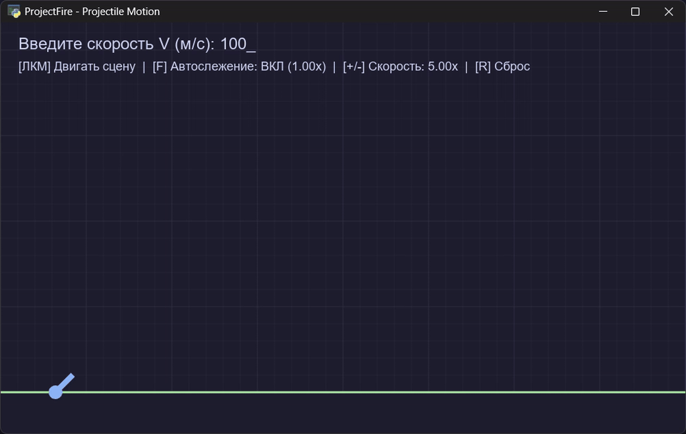

# ProjectFire — Projectile Motion Simulation (OpenGL)

**English** | [Русский](README.ru.md)

An interactive 2D projectile motion simulation built with Python, PyOpenGL, and PySDL3, featuring cyclic parameter input.

## Demo



## Task Description

Create a program demonstrating the motion of a projectile launched with an initial velocity $V$ at an angle $\alpha$ to the horizon. The program must cyclically prompt for new values of velocity $V$ and angle $\alpha$. Exit by pressing `Esc`.

## Tech Stack

- **Language:** Python
- **Graphics & Windowing:** PyOpenGL, PySDL3
- **Text & Arrays:** Pillow, NumPy
- **Package Manager:** `uv`

## Features & Controls

- **Cyclic Parameter Input:** Prompts for velocity $V$ and launch angle $\alpha$ directly inside the OpenGL window after each landing.
- **Interactive Map-Style Camera:** Pan across the scene with the left mouse button (clamped above ground level) and zoom with the mouse wheel.
- **Auto-Follow & Fit:** Automatically keeps the cannon, full trajectory arc, and projectile inside the viewport.
- **Smooth Coordinate Grid:** Two-level logarithmic grid with alpha fading for clear speed and scale perception.

| Key / Action            | Description                          |
| :---------------------- | :----------------------------------- |
| `0–9`, `.`, `Backspace` | Enter velocity $V$ or angle $\alpha$ |
| `Enter`                 | Confirm input and launch             |
| `Left Mouse Drag`       | Pan camera across the scene          |
| `Mouse Wheel`           | Manual zoom in / out                 |
| `F`                     | Toggle camera auto-follow            |
| `+` / `-`               | Adjust simulation speed (`±0.25x`)   |
| `R`                     | Reset scene and camera               |
| `Esc`                   | Quit application                     |

## Build & Run

1. Clone the repository:

```bash
git clone https://github.com/Riflusso/ProjectFire.git
cd ProjectFire
```

2. Sync dependencies and run with `uv`:

```bash
uv run projectfire
```
