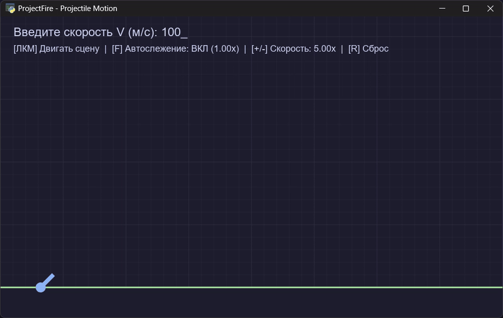

# ProjectFire — Симуляция движения снаряда (OpenGL)

[English](README.md) | **Русский**

Интерактивная 2D-симуляция баллистического движения снаряда на Python, PyOpenGL и PySDL3 с циклическим вводом параметров.

## Демонстрация работы



## Описание задачи

**Лабораторная работа № 3. Вывод движущихся изображений.**  
Требуется составить программу, демонстрирующую движение снаряда, который выпущен с начальной скоростью $V$ под углом $\alpha$ к горизонту. Программа должна циклически запрашивать новые значения скорости $V$ и угла $\alpha$. Выход по клавише `Esc`.

## Стек технологий

- **Язык:** Python
- **Графика и окно:** PyOpenGL, PySDL3
- **Рендер текста и массивы:** Pillow, NumPy
- **Менеджер пакетов:** `uv`

## Возможности и управление

- **Циклический ввод параметров:** Запрос начальной скорости $V$ и угла броска $\alpha$ прямо в окне приложения после каждого приземления снаряда.
- **Интерактивная камера:** Перемещение сцены зажатой левой кнопкой мыши (с ограничением по уровню земли) и масштабирование колёсиком мыши.
- **Автослежение и масштабирование:** Автоматически удерживает в кадре пушку, всю дугу пройденной траектории и летящий снаряд.
- **Плавная координатная сетка:** Двухуровневая логарифмическая сетка с плавным затуханием прозрачности для наглядного восприятия скорости.

| Клавиша / Действие      | Описание                                   |
| :---------------------- | :----------------------------------------- |
| `0–9`, `.`, `Backspace` | Ввод значений скорости $V$ и угла $\alpha$ |
| `Enter`                 | Подтвердить ввод и запустить снаряд        |
| `ЛКМ (перетаскивание)`  | Перемещение камеры по сцене                |
| `Колёсико мыши`         | Ручное изменение масштаба                  |
| `F`                     | Включить / выключить автослежение          |
| `+` / `-`               | Изменить скорость симуляции (`±0.25x`)     |
| `R`                     | Полный сброс сцены и камеры                |
| `Esc`                   | Выход из программы                         |

## Установка и запуск

1. Клонируйте репозиторий:

```bash
git clone https://github.com/Riflusso/ProjectFire.git
cd ProjectFire
```

2. Установите зависимости и запустите проект через `uv`:

```bash
uv run projectfire
```
